## Svrha predavanja
- Pregled **osnovnih tehnologija** koje čine računarstvo u oblaku mogućim:
  - **Mrežne tehnologije** visokog kapaciteta
  - Tehnologije **računarskih postrojenja**
  - Tehnologije **čuvanja podataka**

## Šta nije svrha predavanja
- Cilj **nije** da se ove tehnologije u potpunosti nauče
  - nema vremena
  - dosta toga bi već trebalo da znate
- Pregled je namerno **visokog nivoa i komprimovan**
- Cilj je da razumemo kako se sve **povezuje** i kako čini CC i *mogućim* i *ograničenim*

<!-- ## Ograničenost i mogućnost
- Generalno bilo koja tehnologija koja omogućava nekakvu pod-oblast računarskih nauka, je takođe i glavna međa koja *ograničava* tu pod-oblast.
- Asinhrona priroda komunikacija u modernoj Web aplikaciji povezana sa DOM stablom kao univerzalnim jezikom prikaza (sa svim svojim ograničenjima) je glavni razlog zašto razvoj interfejsa izgleda kako izgleda i ima prioritete koje ima.
- Da su se svi browser alati dogovorili da imaju brz način piksel-savršene kontrole prikaza na vreme, na primer, situacija bi bila znatno drugačija. -->

# Mrežne tehnologije visokog kapaciteta
Kako se podaci kreću?

## "Oblak" zavisi od Interneta {.smaller}
- Računarstvo u oblaku **ne bi postojalo bez Interneta**
  - Internet donosi **dovoljno korisnika** da nam CC uopšte *treba*
  - Internet omogućava korišćenje resursa **distribuiranih po celom svetu**
- Izuzetak: velika firma može imati **lokalni oblak** povezan samo LAN-om
  - Takav oblak **nije dominantan**, većina upotrebe CC je preko Interneta
  - Dovoljno veliki LAN je danas organizovan **slično kao Internet**
  - Više o tome kod arhitektonskih šablona CC instalacija

## Hijerarhija ISP {.smaller}
- Internet skoro da **nema centralno upravljačko telo** (izuzetak je **ICANN**, i on je distribuiran)
- **ICANN** (the Internet Corporation for Assigned Names and Numbers)
- Internet je pre **distribuiran** nego decentralizovan
- Sastoji se od **hijerarhije mreža** koje spajaju ISP-ovi (Internet Service Provider):
  - **Prvi rang** – ogromne nacionalne i trans-nacionalne mreže
  - **Drugi rang** – velike, često regionalne mreže
  - **Treći rang** – srednje mreže, i dalje velike
- ISP bilo kog ranga može imati i **individualne klijente**

## Hijerarhija ISP - ilustracija {.smaller}
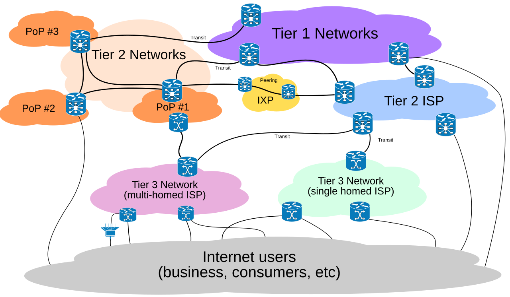{height="430px"}

- **Tranzit** – niži ISP plaća višem za prenos saobraćaja; **peering** – ravnopravna razmena

## PoP i IXP {.smaller}
- **PoP** (Point of Presence) – fizička lokacija na kojoj ISP ima svoju opremu i gde se drugi **priključuju na njegovu mrežu**
  - jedan ISP ima više PoP-ova (npr. po gradovima) da bi bio **blizu korisnika**
- **IXP** (Internet Exchange Point) – **neutralno mesto** gde se priključuje mnogo mreža da bi **direktno razmenjivale saobraćaj**
  - **peering** umesto tranzita: **bez plaćanja** višem ISP-u i sa **manje skokova**
  - primeri: **DE-CIX** (Frankfurt), **AMS-IX** (Amsterdam), **SOX** (Beograd)

## Hijerarhija ISP – primer
- Na FTN-u vam je ISP **ARMUNS** (Akademska računarska mreža Univerziteta u Novom Sadu)
- ARMUNS se spaja sa mrežama drugih univerziteta u **akademsku mrežu Srbije**
- Akademska mreža Srbije je (verovatno) deo **objedinjene evropske akademske mreže**
- Na svakom nivou, viša mreža je **ISP za nižu**

## Zašto nas ovo zanima?
- Arhitektura Interneta pokazuje da u mrežama postoji **lokalnost**
- Razdaljina nije samo geografska (brzina svetlosti i dalje važi) – zavisi od **broja skokova** između uređaja
- Zato se velikim generatorima saobraćaja isplati da se povežu **direktno sa velikim provajderima** ili čak **unutar mreža lokalnih ISP-ova**
  - manje skokova → **manje kašnjenje** i **niži troškovi tranzita**
  - Primer: **Netflix**

## Primer: Netflix – problem {.smaller}
- Netflix u špicu generiše **ogroman deo ukupnog internet saobraćaja**
- Video se prenosi u **velikoj količini i neprekidno** – protok je kritičan
- Klasičan put kroz hijerarhiju:
  - Netflix → ISP 3. ranga → ISP 2. ranga → ISP 1. ranga → ... → korisnik
  - svaki skok dodaje **kašnjenje** i tačku mogućeg **zagušenja**
  - niži ISP plaća višem **tranzit** – trošak raste sa količinom saobraćaja
- Rezultat bi bio: **ogromni troškovi** za Netflix i **buffering** za korisnike

## Primer: Netflix – Open Connect {.smaller}
- **Peering** – direktno povezivanje sa ISP-ovima u tačkama razmene saobraćaja (**IXP**), često bez plaćanja
- **Keš serveri unutar mreža ISP-ova** (*Open Connect Appliances*)
  - Netflix ih besplatno daje ISP-ovima
  - popularan sadržaj se **unapred kopira noću**, kad je mreža neopterećena
  - gledalac dobija video sa servera **samo nekoliko skokova** od sebe
- Korist za **sve strane**: Netflix manje plaća, ISP rasterećuje svoje međunarodne linkove, korisnik ima bolji kvalitet
- Ista ideja **lokalnosti** dovedena do kraja: sadržaj dolazi do korisnika – princip **CDN-a** (Content Delivery Network)

<!-- ## Buffering i keš kod lokalnog ISP-a {.smaller}
- Plejer drži **bafer** – nekoliko sekundi videa unapred
  - ako je protok **manji od bitrate-a** videa, bafer se prazni → **buffering**
  - plejer tada spušta kvalitet (*adaptive bitrate*)
- Zahtev za epizodu ide prvo na **keš server kod lokalnog ISP-a**:
  - **cache hit** – sadržaj je tu → stiže sa par skokova, **stabilan protok**, bafer ostaje pun
  - **cache miss** – keš ga preuzima od izvora (*origin*), pa ga čuva za sledeće korisnike
- Popularan sadržaj se gleda **mnogo puta** → velika većina zahteva je **cache hit**
- Isti fajl putuje kroz međunarodne linkove **jednom**, a ne jednom po gledaocu -->

## CDN – Content Delivery Network {.smaller}
- **CDN** je mreža keš servera (**edge** čvorova) raspoređenih **blizu korisnika** širom sveta
- Korisnik se automatski usmerava na **najbliži ispravan** edge čvor (preko **DNS-a** ili **anycast** rutiranja)
- Edge čvor **kešira** sadržaj sa izvornog servera i služi ga lokalno
  - slike, video, JS/CSS, preuzimanja – sve što je **isto za mnogo korisnika**
- Prednosti:
  - **manje kašnjenje** i manje buffering-a
  - **rasterećen izvorni server** i niži troškovi tranzita
  - otpornost na **skokove saobraćaja** i DDoS napade

## CDN – ilustracija
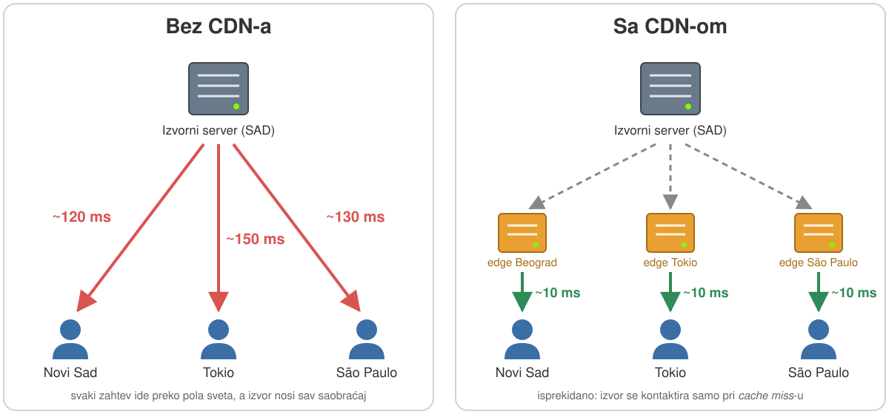{width="1000px"}

## Priroda Internet komunikacije
- Podaci **ne idu uvek istim putanjama**
- Komunikacija unutar ARMUNS-a *najverovatnije* ne napušta ARMUNS, ali to **nije garantovano**
- Podaci mogu ići **bilo kojom putanjom** do odredišta, potencijalno i više njih istovremeno
- Ako se link optereti ili prekine, mreža se **"samoizleči"** i nađe alternativnu putanju

## Kako je ovo moguće?
- Dve fundamentalne tehnologije:
  - **Datagramski paketni** mrežni protokoli
  - **Dinamičko rutiranje**

## Datagramski paketni mrežni protokoli {.smaller}
- Podaci se pakuju u **pakete** ograničene dužine, sa svim **metapodacima** potrebnim za dostavu
- Paketi su **numerisani** – redosled se može rekonstruisati i kad neki paket kasni ili nedostaje
- Paketi su **adresirani** jedinstvenim identifikatorom odredišta:
  - **IP adresa** – 32 bita (IPv4) ili 128 bita (IPv6)
  - **MAC adresa** – 48 bita, unutar Ethernet mreža, vezana za fizički uređaj
- Na odredišnom računaru, aplikacija se bira na osnovu **porta** (16-bitni broj, 1–65535)

## OSI model – slojevi 1–4 {.smaller}
| # | Sloj | Odgovornost | Jedinica | Primer |
|---|------|-------------|----------|--------|
| 1 | **Fizički** | prenos bita variranjem fizičkih veličina | bit | osmožilni kabl |
| 2 | **Logičko-vezni** | prenos između uređaja na **istom medijumu** | *frejm* | Ethernet |
| 3 | **Mrežni** | komunikacija **između različitih mreža** | *paket* | IP |
| 4 | **Transportni** | da **svi podaci stignu** do prave aplikacije | *segment* | TCP |

## OSI model – slojevi 5–7 {.smaller}
| # | Sloj | Odgovornost | Primer |
|---|------|-------------|--------|
| 5 | **Sesijski** | pripadnost sesiji, stanje konekcije, autorizacija, identitet | HTTP (vidi kasnije) |
| 6 | **Prezentacioni** | format podataka | JSON / UTF-8 |
| 7 | **Aplikativni** | radi nešto korisno sa podacima | REST aplikacija |

## TCP/IP model
- U praksi se koristi model iz **TCP/IP** protokol seta sa **pet slojeva**
- Sesijski, prezentacioni i aplikativni sloj su **spojeni u jedan – aplikativni**
- Zato je kod HTTP-a na prošlom slajdu stajalo "vidi kasnije"

## Kombinacija slojeva
:::: {.columns}
::: {.column width="55%"}
- Slojevi se **ugnježdavaju**: Ethernet frejm sadrži IP paket, koji sadrži TCP segment, koji sadrži...
- Nijedan sloj **ne zna šta znače bitovi** koje prenosi
- Zato se sistem **lako menja i proširuje**
- Isti TCP/IP stek radi preko **bežičnih i žičanih** mreža
:::
::: {.column width="45%"}
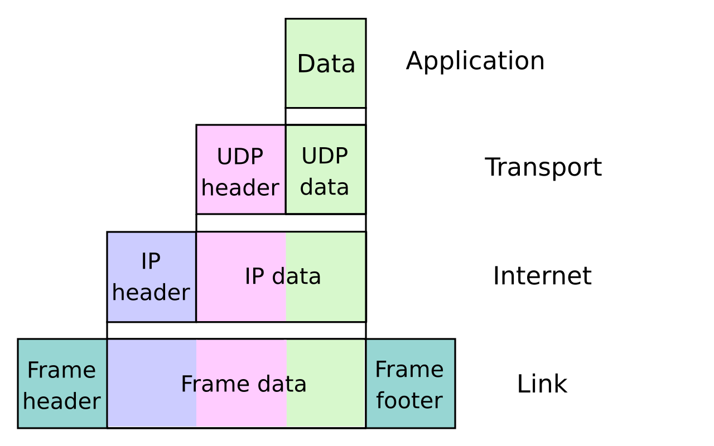
:::
::::

## Tuneliranje
- Sadržaj jedinice transporta je **proizvoljan niz bajtova** – to omogućava *tuneliranje*
- Ideja: podaci **nižeg protokola** se umetnu kao sadržaj **višeg protokola**
- Primalac ih **ekstrahuje** i tretira kao da pripadaju tom nižem protokolu
- Ovo je osnova **VPN** tehnologije

## Tuneliranje – primer
- **SSH** (aplikativni sloj) može u svom sadržaju da prenosi **TCP/IP saobraćaj**
- Tako se **bezbedno** pristupa lokalnim resursima udaljenog računara
  - kanal je **autorizovan i enkriptovan** pre bilo kakve komunikacije
- Dugotrajni tuneli preko namenskih protokola su **VPN** (virtuelne privatne mreže)
  - dve lokalne mreže se **objedinjuju u jednu**

## Dinamičko rutiranje
- **Ruter** je uređaj (interno običan računar) sa **više mrežnih interfejsa** u različitim mrežama
- Njegova funkcija je da **usmerava** (rutira) saobraćaj između tih mreža
- Ruter **ne zna celu topologiju** – zna samo svoje linkove i pravila kuda šalje pakete
- Ta pravila čine **tabelu rutiranja**

## Statičko rutiranje – kućni ruter
- Kućni ruter pamti samo **dva pravila**:
  - adrese `192.168.1.x` → **lokalni interfejs** (često fabrički vezan za svič)
  - sve ostalo → **WAN interfejs** ka provajderu
- Složeniji ruteri imaju složenija pravila, ali **statičke tabele** imaju ograničenu upotrebu

## Zašto dinamičko rutiranje?
- Primer: plaćate **dva provajdera** radi boljeg protoka
  - ruter mora imati **tri interfejsa**
  - oba WAN linka vode ka **celom Internetu**
  - kroz koji link ide koji paket? Zavisi od **trenutnih potreba i stanja**
- Kod provajdera je još složenije:
  - mnogo linkova ka mnogo mreža, čak **više linkova ka istoj mreži**
  - svaki link će *eventualno* dostaviti paket – ali **koji je dovoljno brz?**

## Dinamičko rutiranje
- Ruteri koriste **složene algoritme** koji biraju putanju za svaki paket na osnovu:
  - **topologije** veza
  - **trenutnog stanja** i opterećenja linkova
  - adrese, veličine i tajminga paketa
- Jednako bitan faktor je i **QoS**

## Quality of Service
- Termin ima dva značenja:
  1. **Ostvaren** kvalitet komunikacije između dve tačke
  2. **Traženi** kvalitet komunikacije
- "Uređaj podržava QoS" → misli se na **značenje 2**
- Sistem može neke pakete da tretira kao **hitnije** od drugih

## Uticaj ovih faktora na CC
- Dva ključna mrežna faktora:
  - **Protok** – količina podataka između dve tačke (vaš sistem ↔ krajnji korisnik)
  - **Kašnjenje** – vreme od zahteva do prvih podataka, meri se u **milisekundama**
- Protok se uglavnom rešava **novcem** – zakupi se više kapaciteta
  - rizik postoji kod prenosa **velikih količina podataka** (cena i kapacitet infrastrukture)
- **Kašnjenje je mnogo veći problem**

## Kašnjenje i otvoreni Internet
- Kod dinamičkog rutiranja putanja paketa je **nepredvidiva** unapred
- Zato je i **kašnjenje nepredvidivo**
- QoS garancije se teško održavaju kroz **domene više provajdera**
- Zaključak: CC je **neprikladno** za probleme koji zahtevaju **vrlo malo kašnjenje**

## Moguća rešenja
- Na kašnjenje se može uticati samo preko **mrežne topologije obe strane**
  - nemoguće za krajnjeg korisnika
  - moguće za **komunikaciju dva sistema**
- Sisteme smestiti **bliže u mrežnoj topologiji**
- Koristiti **više CC provajdera**

# Tehnologije računarskih postrojenja
Industrijalizacija računarskih postrojenja

## Šta je računarsko postrojenje
:::: {.columns}
::: {.column width="60%"}
- **Prostor, infrastruktura i oprema** namenjeni pružanju računarskih usluga **na skali industrije**
- Sve je **isključivo podređeno toj svrsi**, bez kompromisa
- Samo tako je **isplativo** održavati koncentraciju kapaciteta dovoljnu za prodaju kao CC usluge
:::
::: {.column width="40%"}
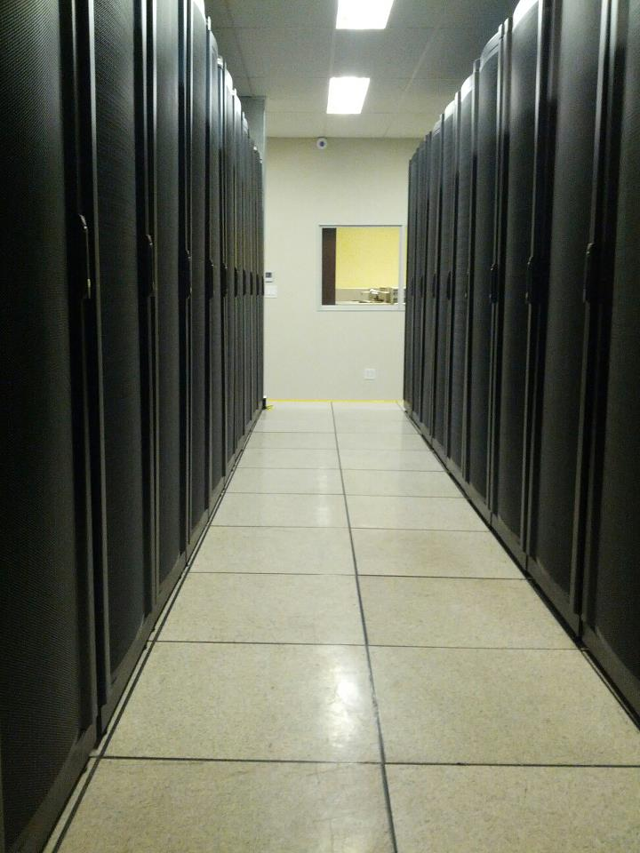{height="480px"}
:::
::::

## Modifikacija prostora
:::: {.columns}
::: {.column width="50%"}
- **Spuštene tavanice i podignuti podovi** – za kablove i hlađenje
- Napredni **protivpožarni sistemi** (ponekad izmeštanjem kiseonika)
- Posebni sistemi **napajanja**
:::
::: {.column width="50%"}
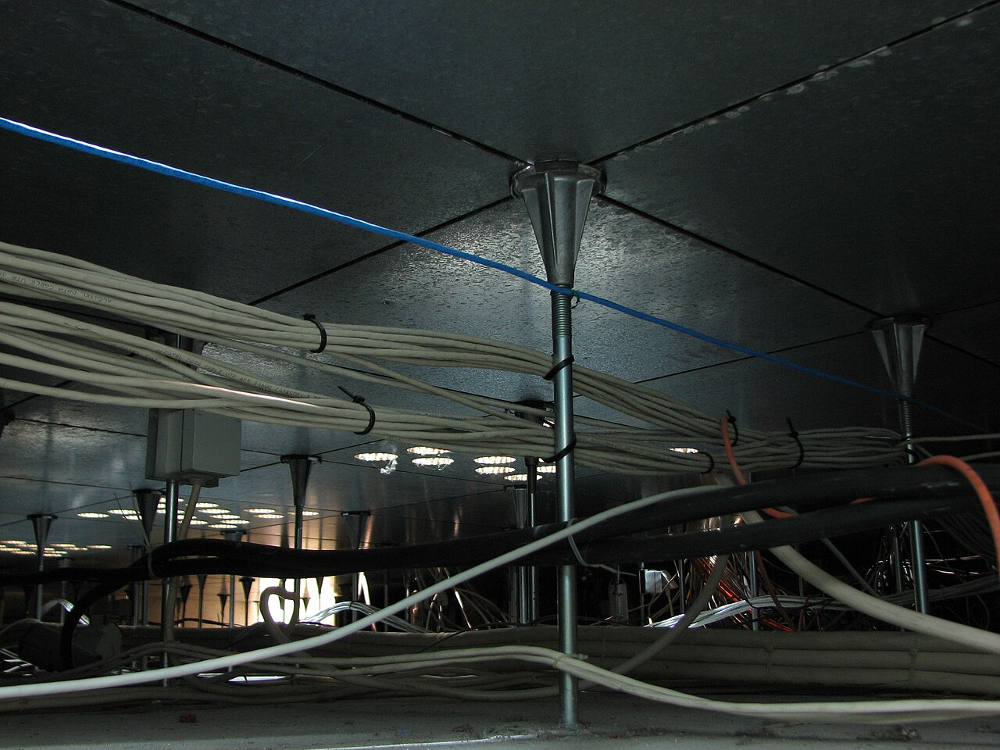
:::
::::

## Modularizacija {.smaller}
:::: {.columns}
::: {.column width="58%"}
- Sva oprema je **standardizovanog oblika** i ide u **standardni rek**
- Standard **IEC 60297**:
  - širina panela opreme: **19 inča** (482.6 mm)
  - jedinica visine **U** = 1¾ inča (44.45 mm)
  - najčešća visina reka je **42U** (~2 m sa ormarom)
- **Teška oprema ide dole** (UPS, diskovi) – stabilnost reka
- Hardver se raspoređuje **optimalno**, bez brige da nešto neće stati
- Delovi se menjaju **brzo i lako** – ključno kod čestih zamena
:::
::: {.column width="42%"}
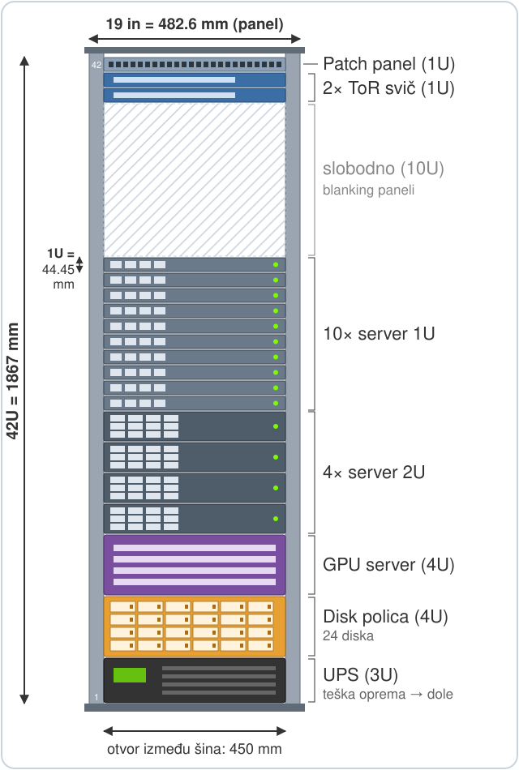{height="560px"}
:::
::::

## Automatizacija i udaljen rad {.smaller}
- Postrojenja su **maksimalno automatizovana**, često **polu-autonomna**
  - sama pokreću i gase računare po potrebi
- **Automatsko kreiranje sistema**: boot preko mreže, *headless* instalacije
  - ne samo virtuelne mašine, nego i instalacija na **"metalu"**
- Ljudska interakcija je, kad god je moguće, **udaljena** (preko obezbeđenog linka)
- Fizičko prisustvo je neminovno samo za **hardverske probleme**

## Pouzdanost
- Vodeće pravilo: **_one is none_**
- **Nema jedinstvenih tačaka otkaza** (SPOF) – svi ključni sistemi su **duplirani**
- Primer: server ima **dva odvojena napajanja**
  - drugo postoji da preuzme **istog trenutka** kad primarno otkaže

## Bezbednost
- Resursi i podaci su na **jednom mestu** – lakše ih je fizički obezbediti
- Fizička zaštita je **izuzetno bitna**: većina sistema **nema zaštitu od direktnog fizičkog pristupa**
- Rešenja:
  - **rigorozna fizička bezbednost** i bezbednosni protokoli
  - **enkripcija podataka u mirovanju** – zaštita od direktne krađe

## Prilagođen primarni hardver
- **Primarni hardver** = elementi sposobni za proračune
- Prilagođen industrijskoj eksploataciji:
  - **veće performanse**
  - **hot-swap** mehanizmi
  - **povećana pouzdanost**

## Prilagođen hardver za čuvanje podataka
- Jedan od najvećih poslova računarskog centra je **čuvanje ogromnih količina podataka**
- Prvo pitanje: **kako se skladište povezuje** sa sistemom?
  - **DAS** (Direct Attached Storage) – direktno na računar preko *host bus adaptera* (HBA), kao klasičan disk
  - **NAS** (Network Attached Storage, u širem smislu) – skladište je na **mreži** na koju se kače računari

## Mreža diskova
- Ključno pitanje: **ko upravlja fajl sistemom?**
  - **SAN** (Storage Area Network) – disku se pristupa **blok po blok**, fajl sistem je **na računaru** koji ga koristi
  - **NAS** (u užem smislu) – poseban uređaj ima **svoj fajl sistem**, pristupa se **na nivou fajla**
- Razlika deluje tehnička, ali određuje **performanse**, **deljenje podataka** i potrebnu **mrežu**

## SAN – pristup na nivou bloka {.smaller}
- Server preko mreže vidi nešto što izgleda kao **lokalni disk** (blok uređaj)
- Taj logički disk se zove **LUN** (Logical Unit Number)
- OS na LUN-u pravi **svoj fajl sistem** (ext4, XFS, NTFS…) i sam njime upravlja
- Mrežom idu samo komande tipa *"pročitaj blokove 1000–1015"*
- Iza toga je obično **storage array**:
  - kontroleri rade **RAID, keširanje i snapshot-ove**
  - iz velikog skupa diskova "iseče" LUN-ove za servere, ali **ne zna ništa o fajlovima**

<!-- ## SAN – ilustracija
{width="900px"} -->

## SAN – prednosti i mane {.smaller}
:::: {.columns}
::: {.column width="50%"}
**Prednosti**

- **Malo kašnjenje, visok protok** – nema prevođenja fajl ↔ blok
- Pogodan za **baze podataka i virtuelizaciju** – sve što očekuje "pravi" disk
- Server može da se **pokreće (boot) sa SAN-a**
:::
::: {.column width="50%"}
**Mane**

- Isti LUN **ne mogu bezbedno da dele dva servera** sa običnim fajl sistemom
  - potreban je **klasterski fajl sistem**
- Klasično **posebna mreža** – skuplja oprema i posebno znanje
:::
::::

## NAS – pristup na nivou fajla
- NAS uređaj **sam ima fajl sistem** na svojim diskovima
- Klijentima ga izlaže kao **deljeni direktorijum** (`\\nas\deljeno` ili `nas:/export`)
- Klijent šalje zahteve tipa *"otvori `/projekti/izvestaj.txt`"* ili *"izlistaj direktorijum"*
- **Samo NAS zna** gde su podaci fizički na diskovima
- Koristi **istu IP mrežu** kao i sve ostalo

## NAS – prednosti i mane {.smaller}
:::: {.columns}
::: {.column width="50%"}
**Prednosti**

- **Deljenje je ugrađeno** – više klijenata pristupa istim fajlovima, NAS rešava zaključavanje
- Radi preko **obične mreže** – jeftinije i jednostavnije
- Korisnici, dozvole i kvote **na jednom mestu**
:::
::: {.column width="50%"}
**Mane**

- **Veći trošak po operaciji** (metapodaci, zaključavanje, više komunikacije)
- **Slabije garancije konzistentnosti** zbog keširanja na klijentima
- Neke aplikacije, posebno **baze podataka**, to loše podnose
:::
::::

## SAN i NAS – poređenje {.smaller}
|                          | SAN                          | NAS                        |
|--------------------------|------------------------------|----------------------------|
| Jedinica pristupa        | **blok**                     | **fajl** / direktorijum    |
| Gde je fajl sistem       | na serveru (klijentu)        | na uređaju za skladištenje |
| Klijent vidi             | lokalni disk                 | mrežni deljeni direktorijum |
| Deljenje između servera  | teško                        | prirodno                   |
| Mreža                    | tipično posebna              | obična IP mreža            |
| Tipična upotreba         | baze, diskovi virtuelnih mašina | deljeni fajlovi, korisnički direktorijumi |

- U praksi se granica briše: mnogi uređaji danas nude **oba načina pristupa**

## Tehnologije koje koriste SAN i NAS {.smaller}
- **SAN** koristi blokovski protokol – praktično uvek **SCSI** (ili noviji **NVMe**)
  - SCSI je **jezik komandi** ("pročitaj ove blokove", "upiši ove podatke")
  - komande putuju preko nekog **transporta**: Fibre Channel, iSCSI, FCoE, InfiniBand
- **NAS** koristi fajl protokole **SMB** i **NFS**
  - definišu **operacije nad fajlovima** ("otvori", "izlistaj", "zaključaj")
  - transport je **obični TCP/IP**

|         | Komande        | Transport                    |
|---------|----------------|------------------------------|
| **SAN** | SCSI / NVMe    | Fibre Channel / Ethernet     |
| **NAS** | SMB / NFS      | TCP/IP                       |

## SCSI {.smaller}
- **SCSI** (Small Computer System Interface) – nastao 80-ih kao magistrala za diskove
- Kabl je zastareo, ali je opstao **SCSI skup komandi**
  - standardni **"jezik"** za čitanje i pisanje blokova
- Uvodi pojmove **inicijator** (računar), **target** (uređaj) i **LUN**
- Iste komande danas idu preko **SAS**-a, **Fibre Channel**-a, **iSCSI**-ja
- SCSI je **protokol** koji SAN koristi, a ne mreža sama po sebi

## Fibre Channel
- **Fibre Channel** (FC) – mreža napravljena **isključivo za skladištenje**
- **Svoji kablovi** (najčešće optika), svičevi i adresiranje – **nije IP mreža**
- Prenosi SCSI komande brzinama **8–128 Gb/s**
- Mreža je **bez gubitaka**: šalje se samo koliko primalac može da primi
- Obično se prave **dve odvojene FC mreže** radi redundanse (*one is none*)

## Ostali transporti za SAN {.smaller}
- **FCoE** (Fibre Channel over Ethernet) – FC frejmovi preko Etherneta
  - ideja: **jedna mreža umesto dve**, ali nije zaživeo koliko se očekivalo
- **iSCSI** – SCSI komande upakovane u **TCP/IP**
  - SAN preko **obične mreže** i jeftinije opreme
- **InfiniBand** – mreža **vrlo malog kašnjenja**, česta u superračunarima
  - podržava **RDMA** – direktan pristup memoriji drugog računara bez učešća procesora
- Novi trend: **NVMe over Fabrics** – ista ideja, prilagođena **SSD** diskovima

## SMB za NAS
- **SMB** (Server Message Block) – fajl protokol **nativan za Windows**
- Na Linux-u ga implementira **Samba**
- **Pamti stanje**: sesije, otvoreni fajlovi, zaključavanja
- Klijent sme da **kešira fajl** dok ga niko drugi ne koristi
- Integrisan sa **Active Directory** i Windows dozvolama
- **SMB3**: enkripcija i više mrežnih veza istovremeno

## NFS za NAS
- **NFS** (Network File System) – Sun Microsystems, 1984, standard u **Unix/Linux** svetu
- **NFSv3** **ne pamti stanje** – restart servera ne smeta klijentima
- **NFSv4** **pamti stanje** – zaključavanje, Kerberos, jedan port
- Česta osnova deljenog skladišta u **virtuelizaciji i Kubernetes-u** (npr. AWS EFS)
- SMB ili NFS? Najčešće odlučuje **ekosistem**: Windows ili Linux

## Kombinacija diskova {.smaller}
- Jedan disk **nije dovoljan** za CC:
  - **Kapacitet** – najveći diskovi su desetine TB, oblak čuva **petabajte**
  - **Brzina** – ograničen protok i broj operacija u sekundi (**IOPS**)
  - **Pouzdanost** – sa desetinama hiljada diskova, otkaz je **svakodnevna** pojava
- Kombinovanjem diskova moguće je **poboljšati sve tri osobine**
- Glavni pristupi: **JBOD**, **RAID** i napredni fajl sistemi (**ZFS**, **btrfs**)

## JBOD
- **JBOD** (Just a Bunch Of Disks) – najprostije kombinovanje
- Diskovi se nadovežu u **jedan veliki logički disk**: kad se prvi napuni, piše se na drugi
- Kapacitet je **zbir kapaciteta**, diskovi mogu biti različitih veličina
- **Nema dobitka u brzini** i **nema redundanse**
- Termin se koristi i za **kućište sa diskovima bez logike** (kombinovanje radi softver)

## RAID – osnovna ideja {.smaller}
- **RAID** (Redundant Array of Independent Disks) – više diskova kao **jedan logički disk**
- Tri osnovna mehanizma:
  - **Striping** – podaci se seku i raspoređuju po diskovima → **brzina**
  - **Mirroring** – isti podaci na više diskova → **pouzdanost**
  - **Parnost** – kontrolna informacija iz koje se **rekonstruiše** izgubljeni disk
- Kombinacije mehanizama daju različite **nivoe RAID-a**

## RAID 0 i RAID 1 {.smaller}
:::: {.columns}
::: {.column width="50%"}
**RAID 0** – samo striping

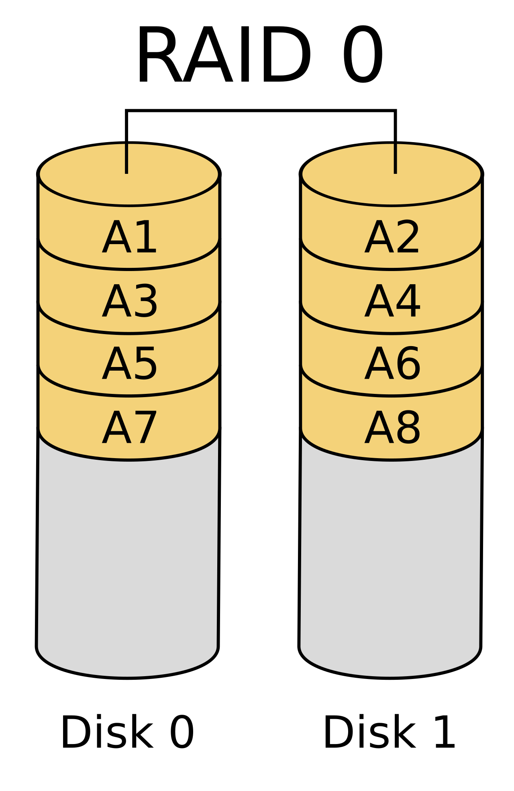{height="170px"}

- Brzina i kapacitet **rastu sa brojem diskova**
- **Nema redundanse**: otkaz bilo kog diska uništava **sve** podatke
- Samo kad su podaci **zamenljivi** (npr. privremeni fajlovi)
:::
::: {.column width="50%"}
**RAID 1** – samo mirroring

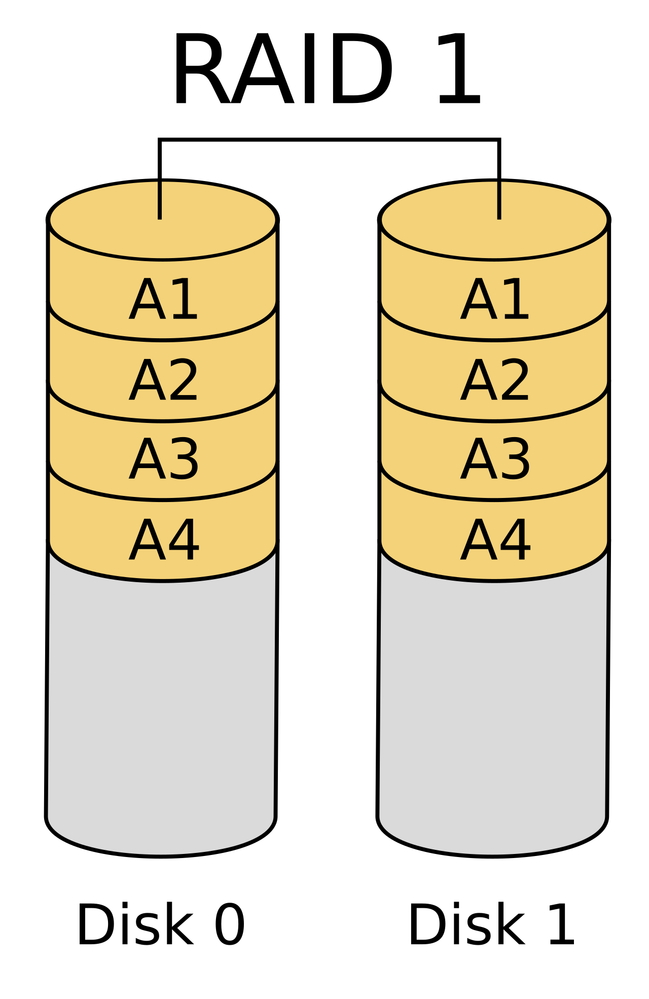{height="170px"}

- Svaki podatak je na **dva ili više** diskova
- Preživljava otkaz **svih diskova osim jednog**
- Čitanje može biti brže, pisanje nije
- Cena: koristi se samo **polovina kapaciteta**
:::
::::

## RAID 5 i RAID 6 {.smaller}
:::: {.columns}
::: {.column width="50%"}
**RAID 5** – striping + parnost

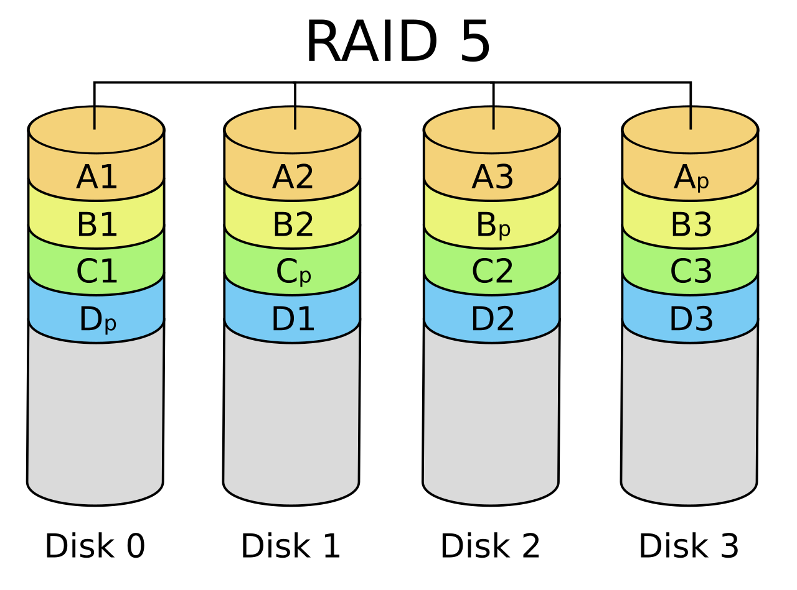{height="160px"}

- Parnost (**XOR**) se upisuje na disk koji se **rotira**
- Otkazan disk se **izračunava iz ostalih**
- Najmanje **3 diska**, gubi se kapacitet **jednog**
- Mana: **sporije pisanje** zbog računanja parnosti
:::
::: {.column width="50%"}
**RAID 6** – *dva* bloka parnosti

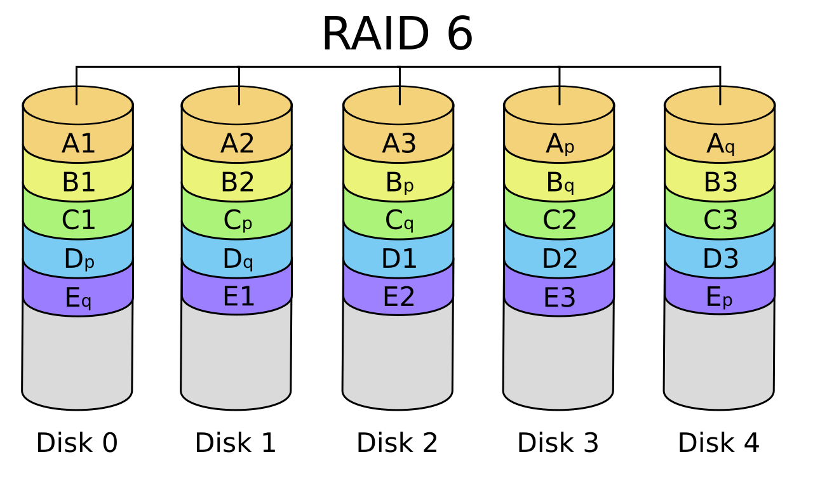{height="160px"}

- Preživljava otkaz **bilo koja dva diska**
- Bitno kod velikih diskova: obnova traje **satima ili danima**, a za to vreme može otkazati još jedan
:::
::::

## RAID 10 {.smaller}
:::: {.columns}
::: {.column width="60%"}
- **RAID 10** (RAID 1+0) – diskovi se upare u **ogledalne parove** (RAID 1), pa se podaci dele po parovima (RAID 0)
- **Brzina striping-a + pouzdanost mirroring-a**, bez računanja parnosti
- Preživljava otkaz **jednog diska u svakom paru**
- **Brza obnova** – samo se kopira disk iz para
- Cena: **polovina kapaciteta**
- Čest izbor za **baze podataka** i brzo pisanje
:::
::: {.column width="40%"}
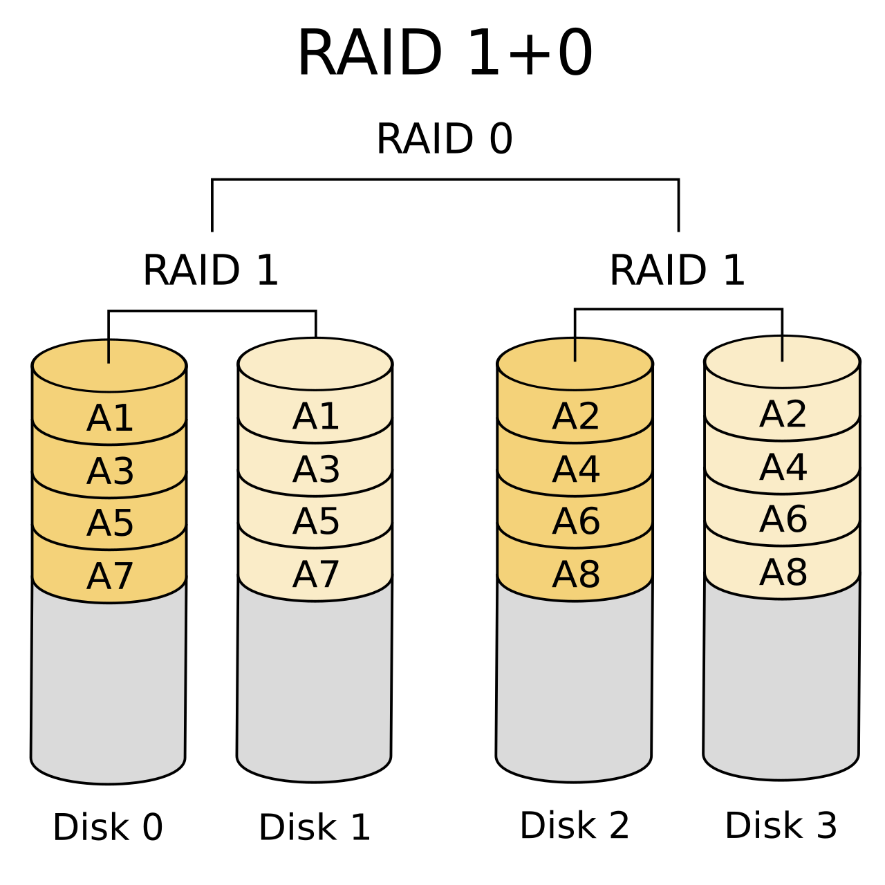
:::
::::

RAID ilustracije: Wikimedia Commons (Cburnett, CC BY-SA 3.0)

## Poređenje RAID nivoa {.smaller}
| Nivo    | Min. diskova | Iskorišćen kapacitet | Preživljava otkaz | Brzina pisanja |
|---------|--------------|----------------------|-------------------|----------------|
| JBOD    | 1            | 100%                 | ne                | kao jedan disk |
| RAID 0  | 2            | 100%                 | ne                | **najbolja**   |
| RAID 1  | 2            | 50%                  | n−1 diskova       | kao jedan disk |
| RAID 5  | 3            | (n−1)/n              | 1 disk            | sporija        |
| RAID 6  | 4            | (n−2)/n              | 2 diska           | najsporija     |
| RAID 10 | 4            | 50%                  | 1 po paru         | dobra          |

## Hardverski i softverski RAID {.smaller}
:::: {.columns}
::: {.column width="50%"}
**Hardverski RAID**

- Logiku radi **kontrolerska kartica**
- OS vidi **samo jedan disk**
- Često ima **keš sa baterijom** – brže pisanje
- Mana: **zavisnost od kontrolera** – ako otkaže, treba isti model
:::
::: {.column width="50%"}
**Softverski RAID**

- Logiku radi **operativni sistem** (npr. `mdadm`)
- Današnji procesori → **mala razlika** u performansama
- **Fleksibilniji** i nezavisan od hardvera
:::
::::

- Trend u oblaku: pouzdanost se sve više rešava **u softveru**

## Ograničenja RAID-a {.smaller}
- **RAID nije bekap**
  - brisanje, greška u aplikaciji ili ransomware se **preslikaju na sve diskove**
- **Obnova je rizična**
  - preostali diskovi rade pod punim opterećenjem, a često su **iste starosti i serije**
- **RAID ne zna da li su podaci ispravni**
  - *silent data corruption* prolazi neprimećeno
- **Write hole**
  - nestanak struje usred upisa → podaci i parnost **neusklađeni**

## Napredni fajl sistemi {.smaller}
- **ZFS** i **btrfs** objedinjuju **upravljanje diskovima i fajl sistem**
  - sami rade striping, mirroring i parnost – **bez posebnog RAID sloja**
- **Kontrolne sume** – svako čitanje se proverava, oštećen blok se **automatski popravlja**
- **Copy-on-write** – podaci se ne prepisuju na mestu → **nema write hole**
- **Snapshot-ovi** – trenutno, gotovo besplatno "zamrzavanje" stanja
- Napomena: RAID 5/6 kod btrfs-a je i dalje **nestabilan** – u produkciji se češće koristi **ZFS**

## Skladištenje na skali oblaka
- Ni server sa RAID-om **nije dovoljan** – i **ceo server** može da otkaže
- Ista ideja se podiže na nivo **mreže servera**: distribuirano skladište (**Ceph**, **HDFS**)
  - replike na više servera, u **različitim rekovima ili zgradama**
- Ovo stoji iza servisa kao što je **Amazon S3**

## Prilagođen mrežni hardver
- Računarskim centrima treba **jako brz mrežni pristup**
- Rešenje: **redundantne veze** i jako brze mrežne tehnologije
- **Optika** – jedno vlakno, **multipleksirano**, nosi saobraćaj mnogo gigabitnih linkova

## Mrežni hardver svestan sadržaja
- Posebni mrežni elementi koji **ubrzavaju web**
- Mreža **razume šta paketi rade na aplikativnom nivou**
- Podaci se mogu **preprocesirati** ili **enkriptovati/dekriptovati** još u mreži
- Znajući čemu su paketi namenjeni, moguće je efikasno **balansiranje opterećenja**

## Kraj {.center}
Hvala na pažnji!